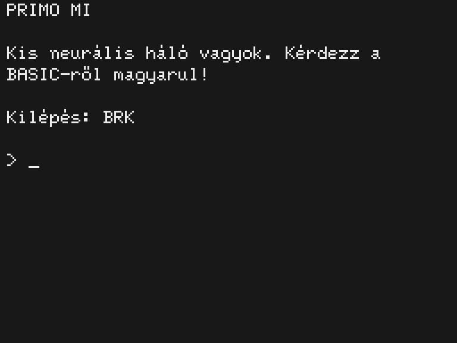
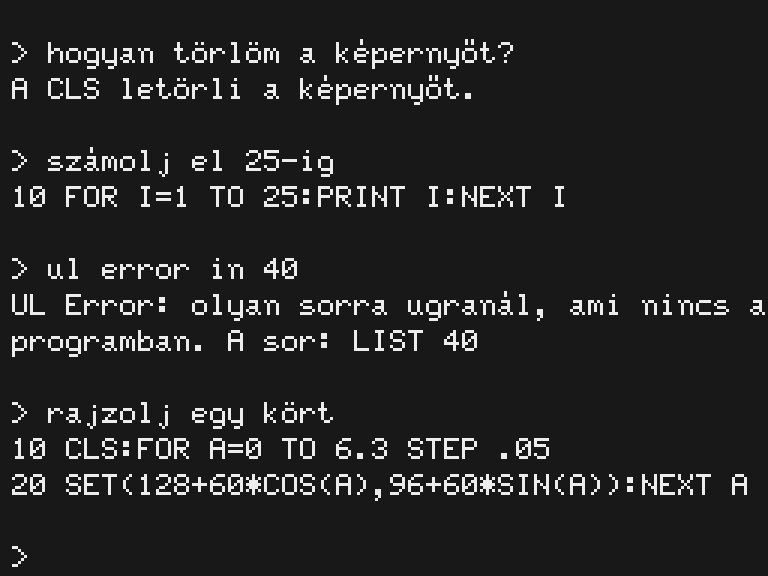

# PRIMO MI

A neural network that runs on the Microkey PRIMO A-64 (Hungarian Z80 home
computer, 1984) and answers questions about the machine's BASIC, typed in
Hungarian. MI is the Hungarian abbreviation for AI. It does not write its
answers: it reads the question and chooses one of its prepared answers.
Numbers in the question (a line number, how far to count, a sum) are put into
the answer by fixed rules.

| | |
|---|---|
|  |  |

`MI.ptp` is the tape: `LOAD`, `RUN`, then type a question. `BRK` returns to
BASIC. `media/mi.mp4` shows four questions typed and answered in real time.

## What it answers

    > két szót hogy ragasztok össze
    Szövegeket a + jellel fűzöl össze. Például: PRINT "alma"+"fa"

    > miért ír nf errort a 50-es sorban
    NF Error: NEXT van, de nincs hozzá FOR. A sor: LIST 50

    > csinálj visszaszámlálást 20-tól
    10 FOR I=20 TO 1 STEP -1:PRINT I:NEXT I
    20 PRINT "start!"

    > mennyi 12*7
    Írd be: PRINT 12*7

    > szeretem a palacsintát
    Ezt nem tudom. A BASIC-ről kérdezz!

It knows 74 BASIC words, 23 error messages, 28 small programs, 42 how-tos and
ideas, and a little small talk. Of 2 070 questions written by two writers who
never saw the training questions, it chooses the right answer for 93 %
(91.2 % of one writer's, 94.8 % of the other's), and for 91 % when they are
typed with slips and without accents. Those writers were language models asked
to write as children, not children.

A question that sounds like BASIC but is outside its answers gets the nearest
answer, not "I do not know": "hogyan nyomtatok" is answered with `INKEY$`. When
two answers score almost the same, it says "Nem biztos, hogy jól értelek."
first; that happened before 73 of the 2 070 answers, 42 of them wrong.

## Specifications

| | |
|---|---|
| machine | PRIMO A-64: Z80 at 2.5 MHz, 48 KB RAM. Not tested on real hardware |
| tape | 36 KB: 22 KB network, 11.5 KB answers; 4 KB of memory stay free |
| network | 1024 x 64 table -> 64 hidden units -> 176 answers |
| weights | 65 536 of two bits (-1, 0, +1) and 11 264 of four bits |
| speed | 0.68 s from RETURN to the answer (0.53 to 0.89) |
| right answers | 91.2 % and 94.8 % of 1 035 held-out questions each |
| typed sloppily | 89.5 % and 93.4 % |
| off-topic questions | 115 of 120 get "Ezt nem tudom" |
| wrong without the "not sure" line | 6.7 % and 3.3 % |

## How it works

**Reading.** The line is put in lower case, accents are dropped and every
digit becomes the same symbol. All runs of one to four symbols are taken (about
95 for a question), and each is hashed to one of 1024 rows of a table.

**Network.** A row holds 64 entries of -1, 0 or +1. The rows of all the runs
are added, the 64 sums go through a tanh table, and a second layer turns them
into one score per answer. The highest score wins.

**Arithmetic.** Integers only. The first layer needs no multiplication at all:
a row is 64 bits "add one" and 64 bits "take one off". For the second layer the
16 possible products of a hidden unit are built by repeated addition, and then
every weight is one table lookup and one add.

**Numbers.** The largest number in the question, or the sum typed in it, is
copied into the answer where the answer has a place for it: `LIST 50`,
`TO 25`, `PRINT 12*7`. This part is ordinary program code, not the network.

**Typing.** The ROM's own line editor reads the question, so the cursor, the
accented keys and the delete key work as in BASIC.

## How it was made

**Answers.** `train/kb.py` holds the 176 answers. Every BASIC statement and
program in them is typed into the emulated PRIMO by `tools/kbcheck.py`, listed
and run: 56 statements and 28 programs, also with other numbers filled in. That
is how the answers know that this BASIC wants `SET(X,Y)` with brackets, that
`LIST` goes on only while a key is held, and that power is typed with the up
arrow.

**Questions.** Three language models, each briefed as a different kind of
child, wrote 9 972 questions for the answers. Training draws from them and
from generated questions about each BASIC word and error message, and roughs
them up the way children type. Ordinary Hungarian sentences (from Tatoeba and
from machine-translated TinyStories) teach it what is not about BASIC.

**Training.** First with floating point, then with the PRIMO's two-bit and
four-bit weights in the forward pass; a minute and a half on a GPU.

**Checking.** `train/ref_helper.py` repeats the Z80 program in Python on the
same bytes; run without arguments, it answers questions in a terminal.
`make check` runs the tape in the [PrimGO](https://github.com/no1msd/primgo)
emulator (unmodified, driven without a window), types questions on its
keyboard and compares the chosen answer and the text on its screen with the
reference: 2 090 of 2 090 lines identical.

## Building

    make                # the tape                           needs z88dk, python3
    make emu            # the headless emulator              needs go, git
    make check          # MI.ptp against its reference
    make kbcheck        # the answers' BASIC on the emulated PRIMO
    make media          # screenshots and the video          needs ffmpeg

    make data           # ordinary Hungarian sentences       needs a GPU,
    make train          # train the network                  PyTorch,
    make model          # export it to mi/ and test it       transformers

`z80/mi.asm` is the program, `mi/` the network and the answers as the program
includes them, `data/basic/` the questions, `train/` the training code,
`tools/` the tape and emulator tools.
